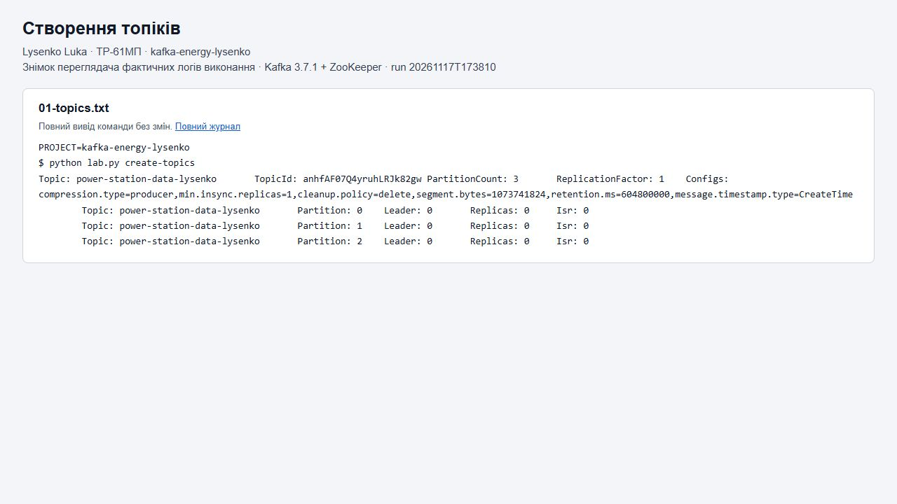
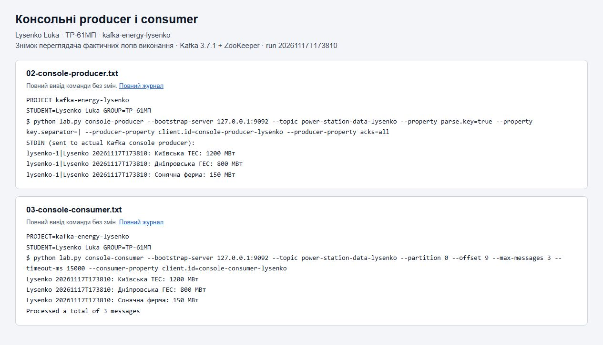
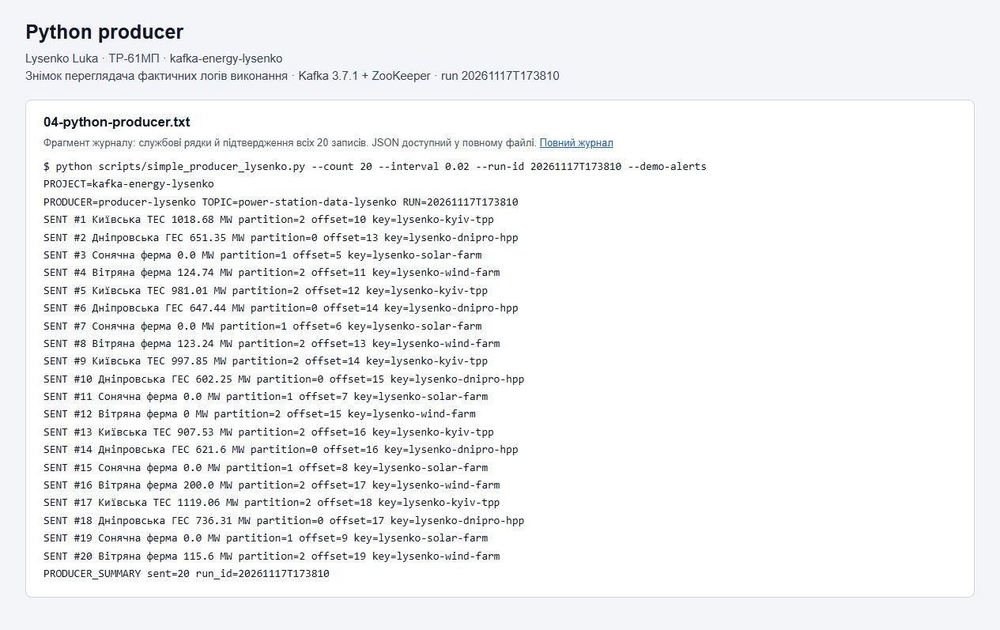
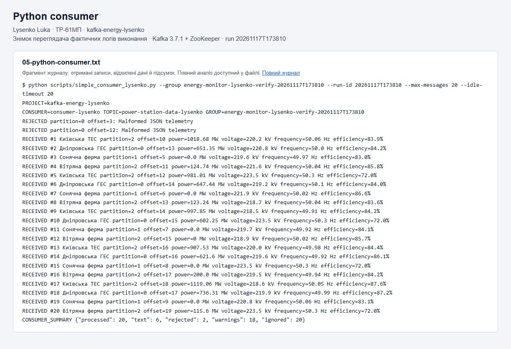
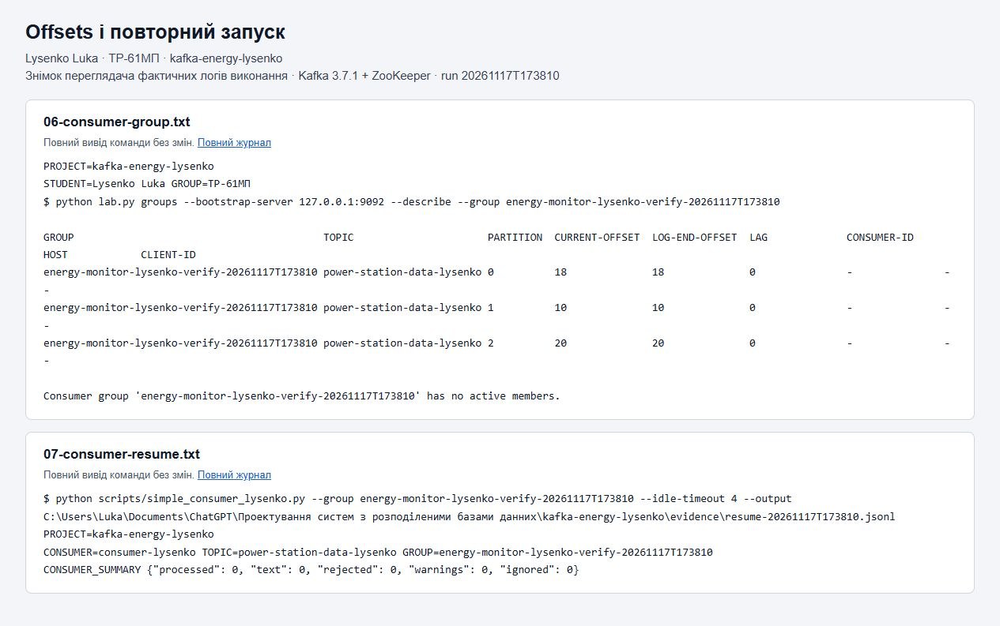
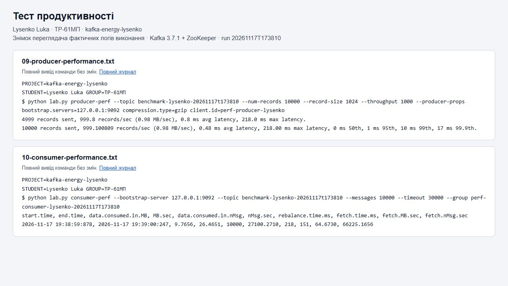
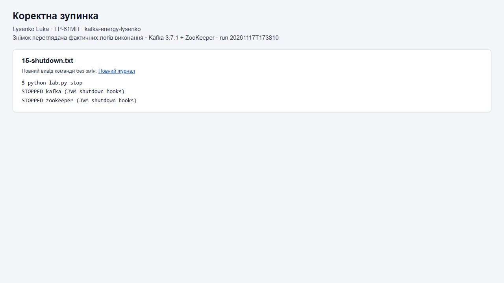

# Практична робота з Apache Kafka

**Дисципліна:** Проєктування систем з розподіленими базами даних  
**Виконав:** Lysenko Luka  
**Група:** ТР-61МП  
**Дата виконання:** 17 листопада 2026 року  
**Проєкт:** `kafka-energy-lysenko`  
**Репозиторій з лістингом:** [GitHub](https://github.com/Lukadjent/kafka-energy-lysenko)

## Тема

Основи роботи з Apache Kafka у розподілених базах даних.

## Мета

Ознайомитися з архітектурою Kafka, створенням топіків і партицій, передаванням повідомлень через консольні й Python-клієнти, керуванням offsets та моніторингом. Розробити навчальну систему передавання й аналізу телеметрії електростанцій.

## Результат роботи

Створено й запущено Kafka 3.7.1 із ZooKeeper. Консольні клієнти передали 3 із 3 повідомлень. Python producer і consumer передали й проаналізували 20 із 20 JSON-записів поточного прогону. Перевірено порядок записів кожної станції, обробку текстових повідомлень, відхилення некоректного JSON, аварійні значення та відновлення читання після commit. Окремий тест передав і прочитав 10 000 записів по 1024 байти. Успішно виконано 11 інтеграційних перевірок і 4 модульні тести.

Дані станцій синтетичні. Це навчальна модель, а пороги з методички не є рекомендаціями для експлуатації реальної енергосистеми. Усі наведені показники отримано фактичним запуском; повні журнали доступні в [evidence](evidence/verification.json). Ідентифікатор фінального прогону: `20261117T173810`. Повторні перевірки залишають попередні записи у Kafka; лічильник 20 стосується саме цього `run_id`.

## Архітектура і середовище

```text
Датчики станцій (генератор синтетичних даних)
                 |
        producer-lysenko (Python, JSON, gzip)
                 |
        Kafka 3.7.1, broker.id=0, 127.0.0.1:9092
        power-station-data-lysenko, 3 partitions, RF=1
                 |
        consumer-lysenko, group energy-monitor-lysenko
                 |
        Аналіз порогів -> JSONL результатів -> commit offset+1

ZooKeeper: 127.0.0.1:2181, координація брокера
Консольні Java producer/consumer: той самий основний топік
Benchmark: окремий топік, щоб двійкові тестові дані не змішувалися з JSON
```

| Компонент | Використано |
|---|---|
| ОС | Windows x64 |
| Kafka | Apache Kafka 2.13-3.7.1, режим ZooKeeper |
| Java | Microsoft OpenJDK 17, портативний JDK |
| Python під час перевірки | 3.12.14 |
| Python-клієнт | kafka-python 2.2.9 |
| Стиснення | gzip |
| Студент у назвах | `lysenko` |

Розгортання локальне: один брокер і replication factor 1. Воно демонструє поділ на партиції, але не забезпечує резервування при втраті брокера. `acks=all` тут означає підтвердження єдиною доступною реплікою.

## Структура проєкту

```text
kafka-energy-lysenko/
  config/                  конфігурації Kafka, ZooKeeper і студента
  scripts/                 producer, consumer, перевірки та формування звіту
  tools/LabService.java    локальний контроль коректної зупинки JVM
  tests/                   перевірки правил аналізу телеметрії
  evidence/                фактичні журнали, JSONL і скріншоти
  lab.py                   запуск служб та офіційних Java CLI
  run.ps1                  зручний запуск у Windows
  requirements.txt         закріплена Python-залежність
  .runtime/                завантажені залежності, у Git не додаються
  data/                    журнали повідомлень Kafka і ZooKeeper, у Git не додаються
  logs/                    технічні логи JVM, у Git не додаються
```

## Порядок запуску

Потрібен Python 3.12 або новіший. Команди виконуються в PowerShell із папки `kafka-energy-lysenko`. `run.ps1` шукає Python у PATH, через `py` або в локальному bundled runtime Codex. Java та Kafka встановлюються лише всередині `.runtime`, без зміни системних змінних.

```powershell
.\run.ps1 setup
.\run.ps1 start
.\run.ps1 create-topics
.\run.ps1 status
```

`setup` завантажує Kafka з архіву Apache, Java з Microsoft і wheel з PyPI. Перед розпакуванням перевіряються SHA-512 або SHA-256. Список джерел і контрольних сум зберігається у `.runtime/downloads.json`.

Для інтерактивної демонстрації в першому терміналі:

```powershell
.\run.ps1 consumer
```

У другому терміналі:

```powershell
.\run.ps1 producer --count 20 --interval 1 --demo-alerts
```

Без `--count` producer працює до Ctrl+C. Consumer без `--max-messages` читає без обмеження; `--idle-timeout` задає завершення за відсутності нових повідомлень.

Повна відтворювана перевірка та зупинка:

```powershell
.\run.ps1 test
.\run.ps1 verify
.\run.ps1 stop
```

`verify` записує результати у `evidence/` і додає навчальні записи до основного топіка. Для кожного прогону створює окрему consumer group і окремий benchmark-топік. Для демонстрації роботи з партиціями створює додатковий топік і збільшує кількість партицій із 2 до 4.

## Створення і перевірка топіків

| Топік | Партицій | Replication factor | Призначення |
|---|---:|---:|---|
| `power-station-data-lysenko` | 3 | 1 | Основна телеметрія і консольна демонстрація |
| `power-telemetry-lysenko` | 3 | 1 | Додаткова телеметрія |
| `grid-alerts-lysenko` | 2 | 1 | Канал сповіщень, підготовлений для розширення |
| `energy-consumption-lysenko` | 4 | 1 | Дані споживання, підготовлений канал |
| `weather-data-lysenko` | 2 | 1 | Погодні дані, підготовлений канал |

Додаткові канали створено; у цій роботі Python consumer виводить попередження в лог і JSONL, а не публікує їх у `grid-alerts-lysenko`. Політика зберігання топіків: `retention.ms=604800000`, тобто 7 діб.

```powershell
python lab.py topics --bootstrap-server 127.0.0.1:9092 --list
python lab.py topics --bootstrap-server 127.0.0.1:9092 --describe --topic power-station-data-lysenko
```



Повний вивід: [створення та опис](evidence/01-topics.txt), [збільшення партицій](evidence/08-topic-operations.txt).

## Консольні producer і consumer

Використано оригінальні Java-класи Kafka `kafka.tools.ConsoleProducer` та `kafka.tools.ConsoleConsumer`. `lab.py` запускає ті самі класи, що й офіційні `.bat`, з коротким classpath через wildcard. Це дозволяє працювати в довгому шляху з пробілами та українськими символами.

```powershell
python lab.py console-producer --bootstrap-server 127.0.0.1:9092 --topic power-station-data-lysenko --producer-property client.id=console-producer-lysenko
python lab.py console-consumer --bootstrap-server 127.0.0.1:9092 --topic power-station-data-lysenko --from-beginning --consumer-property client.id=console-consumer-lysenko
```

Під час автоматичної перевірки три повідомлення надсилаються з однаковим ключем у партицію 0, а consumer читає з попередньо виміряного кінцевого offset цієї партиції. Так перевіряються саме нові записи навіть після повторного запуску. У всіх трьох отриманих рядках текст і кирилиця збіглися з надісланими.



Журнали: [producer](evidence/02-console-producer.txt), [consumer](evidence/03-console-consumer.txt).

## Python producer

[simple_producer_lysenko.py](scripts/simple_producer_lysenko.py) генерує дані ТЕС, ГЕС, сонячної та вітряної станцій. Поля: ідентифікатор і назва станції, тип, UTC timestamp, потужність у МВт, напруга у кВ, частота у Гц, ККД, версія схеми та номер запису. `run_id` дозволяє відокремити результати прогонів.

Ключ `lysenko-<station_id>` закріплює потік станції за однією партицією. Налаштовано JSON/UTF-8, `acks=all`, 3 повтори, gzip та `max_in_flight_requests_per_connection=1` для збереження порядку при retries. Відправлення підтверджується через `future.get()`, після завершення виконуються `flush()` і `close()`. Це не транзакційний або ідемпотентний producer; можливі дублікати при неоднозначному результаті повторної спроби.



Фактично підтверджено 20 записів; використані партиції: `[0, 1, 2]`. Повний JSON і offsets містяться в [журналі producer](evidence/04-python-producer.txt).

## Python consumer і аналіз

[simple_consumer_lysenko.py](scripts/simple_consumer_lysenko.py) читає основний топік, перевіряє структуру та числові значення, аналізує потужність, напругу, частоту й ККД. Текст із консольної демонстрації зберігається як `kind=text`; пошкоджений JSON зберігається як `kind=rejected` разом із причиною та hex-поданням. Некоректні записи не обривають читання.

У навчальному режимі `--demo-alerts` кожен п'ятий запис має напругу 223.5 кВ, частоту 50.3 Гц та ККД 72%. Consumer виявив усі 4 такі події. Загальна кількість попереджень у 20 записах: 18.



Повний [лог consumer](evidence/05-python-consumer.txt) і [структуровані результати JSONL](evidence/processed.jsonl) містять параметри кожного запису, партицію, offset та висновки аналізу.

Скріншоти у звіті зроблено у браузерному переглядачі фактичних логів виконання. Це не знімки вікон Windows Terminal. На зображеннях Python-клієнтів показано підписані фрагменти журналів; поруч доступні повні незмінені файли.

## Offsets і відновлення читання

Автоматичний commit вимкнено. Після аналізу й запису результату в JSONL із `flush()` consumer комітить `offset+1` тільки обробленого запису відповідної партиції. Якщо обробка або запис у файл завершується помилкою, цей offset не комітиться. Після аварії можливе повторення запису між збереженням результату та commit, тому гарантія обробки є at least once; для exactly once потрібне додаткове узгодження або дедуплікація результатів.

Група фінального прогону: `energy-monitor-lysenko-verify-20261117T173810`.

| Партиція | Committed offset | Log end offset | Lag |
|---:|---:|---:|---:|
| 0 | 18 | 18 | 0 |
| 1 | 10 | 10 | 0 |
| 2 | 20 | 20 | 0 |

Повторний запуск тієї самої групи завершився з нульовими лічильниками: вже оброблені повідомлення повторно не прочитано. `auto_offset_reset=earliest` застосовується лише за відсутності дійсного committed offset. Новий `group_id` має власну позицію читання.



Журнали: [опис групи](evidence/06-consumer-group.txt), [повторний запуск](evidence/07-consumer-resume.txt).

## Тест продуктивності

Використано окремий топік `benchmark-lysenko-20261117t173810` з 3 партиціями. Producer надсилав 10 000 записів по 1024 байти з gzip та обмеженням 1000 записів/с. Consumer прочитав рівно 10 000 записів. Це локальний короткий тест, а не оцінка максимальної продуктивності Kafka.

```text
10000 records sent, 999.100809 records/sec (0.98 MB/sec), 0.48 ms avg latency, 218.00 ms max latency, 0 ms 50th, 1 ms 95th, 10 ms 99th, 17 ms 99.9th.
```

| Показник consumer | Фактичне значення |
|---|---:|
| Обсяг прикладних даних, MiB | 9.7656 |
| Загальна швидкість, MiB/с | 26.4651 |
| Прочитано повідомлень | 10000 |
| Загальна швидкість, повідомлень/с | 27100.2710 |
| Час rebalance, мс | 218 |
| Час fetch, мс | 151 |
| Швидкість фази fetch, MiB/с | 64.6730 |
| Швидкість фази fetch, повідомлень/с | 66225.1656 |

Обсяг у perf-утиліті обчислено з розміру повідомлень; це не вимір мережевого трафіку після gzip. Producer обмежено параметром `--throughput 1000`, тому його результат не можна трактувати як граничну пропускну здатність. Показники fetch не включають увесь час приєднання до групи.



Повні журнали: [producer performance](evidence/09-producer-performance.txt), [consumer performance](evidence/10-consumer-performance.txt).

## Адміністрування і завершення роботи

Перевірено [API брокера](evidence/11-broker-api.txt), [директорії журналів](evidence/12-log-directories.txt), [конфігурацію брокера](evidence/13-broker-config.txt) та [конфігурацію основного топіка](evidence/14-topic-config.txt).

`kafka-log-dirs --describe` описує журнали реплік. Поле `offsetLag` у цій команді не є lag споживача; для споживача використано `consumer-groups --describe`.

Зупинка виконується в порядку Kafka, потім ZooKeeper. Локальний Java-лаунчер приймає команду через loopback із випадковим токеном і викликає `System.exit(0)`, що запускає штатні JVM shutdown hooks. Лаунчер очікує закриття портів. Примусове завершення всіх Java-процесів не використовується. Дані не видаляються.



## Уточнення до методички й обмеження

- Kafka залишено версії 3.7.1 за завданням; це історична навчальна версія, а не актуальний реліз.
- У `.properties` пояснення винесено в окремі коментарі. Inline `#` після чисел і адрес стає частиною значення та може зірвати запуск.
- Java `.properties` з абсолютними шляхами генеруються з Unicode escapes. Це зберігає правильні українські назви папок у Windows.
- Замість старої `kafka-python==2.0.2` використано 2.2.9 для роботи з Python 3.12. Залежності для Avro, matplotlib і pandas не встановлювалися: у цьому завданні вони не використовуються.
- Сталу групу з ручним commit застосовано для повсякденної роботи. Унікальну групу створює лише скрипт перевірки, щоб ізолювати прогін.
- Під час експерименту видалення топіка на нативній Windows Kafka 3.7.1 завершилося `AccessDeniedException` під час перейменування log-файлів і зупинило брокер. Тому успішний автоматичний прогін перевіряє створення, опис і збільшення партицій, а тестові топіки залишає. Видалення не позначено як успішно перевірене; для нього потрібне підтримуване Linux-середовище або окрема перевірка цього обмеження.
- Одноброкерна конфігурація й PLAINTEXT на loopback призначені для локальної навчальної роботи. Реплікація між кількома брокерами, Schema Registry і запис у зовнішню СУБД тут не розгортаються.

## Відповіді на контрольні питання

**1. Яка різниця між topic і partition?** Topic є логічним потоком повідомлень. Partition є впорядкованим журналом усередині цього потоку й одиницею розподілу даних та роботи між споживачами. Порядок гарантується в межах партиції; загального порядку між партиціями немає.

**2. Як працює replication?** Кожна партиція має leader і, за replication factor більше 1, followers на інших брокерах. Клієнти записують через leader; followers копіюють журнал. ISR містить синхронізовані репліки. У разі відмови leader можливе обрання нового leader; рівень збереження залежить від ISR і налаштувань підтвердження. У цій роботі RF=1, тому резервної копії на іншому брокері немає.

**3. Чому Kafka підходить для IoT?** Вона відокремлює датчики від систем обробки, буферизує потоки, масштабує читання через партиції та дозволяє повторно обробляти збережені події. Це корисно для великої кількості вимірювань і кількох незалежних споживачів. Вибір залежить від вимог до затримки, ресурсів та доступності мережі; Kafka не замінює протоколи самих датчиків.

**4. Як налаштувати offset management?** Використати сталий `group_id`, вибрати поведінку за відсутності offsets через `auto_offset_reset`, а commit робити після успішної обробки. Ручний commit із `enable_auto_commit=False` дозволяє контролювати момент підтвердження. Комітиться позиція наступного запису, тобто `offset+1`. Для повторної обробки можна створити нову групу або керовано скинути offsets неактивної групи.

**5. Які переваги Schema Registry?** Він централізує версії схем, перевіряє їхню сумісність і допомагає producer та consumer узгоджено змінювати формат даних. Для енергетичної телеметрії це зменшує ризик розбіжностей у назвах полів, типах і одиницях вимірювання. У цьому проєкті використано JSON із `schema_version` і локальною валідацією; окремого Schema Registry немає.

## Висновок

Реалізовано й перевірено передавання синтетичних даних електростанцій через Kafka 3.7.1, аналіз Python consumer, збереження offsets і повторний запуск без перечитування підтверджених записів. Підтверджено консольний обмін, обробку 20 JSON-повідомлень та performance-тест на 10 000 записів. Обмеження нативної Windows при видаленні топіків зафіксовано окремо.

## Джерела

- Наданий PDF «Практична робота Kafka», 33 сторінки: умови, приклади та вимоги до звіту.
- [Apache Kafka 3.7 Quick Start](https://kafka.apache.org/37/getting-started/quickstart/).
- [Apache Kafka 3.7 документація](https://kafka.apache.org/37/).
- [KafkaProducer у kafka-python 2.2.9](https://kafka-python.readthedocs.io/en/2.2.9/apidoc/KafkaProducer.html).
- [KafkaConsumer у kafka-python 2.2.9](https://kafka-python.readthedocs.io/en/2.2.9/apidoc/KafkaConsumer.html).
- [Microsoft Build of OpenJDK](https://learn.microsoft.com/java/openjdk/download).

Репозиторій із лістингом та звітом потрібно зберігати щонайменше три роки відповідно до вимог практичної роботи.
